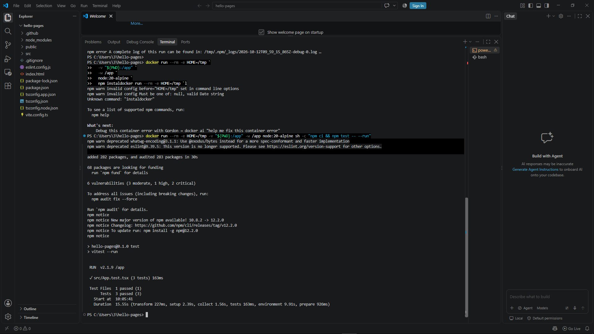
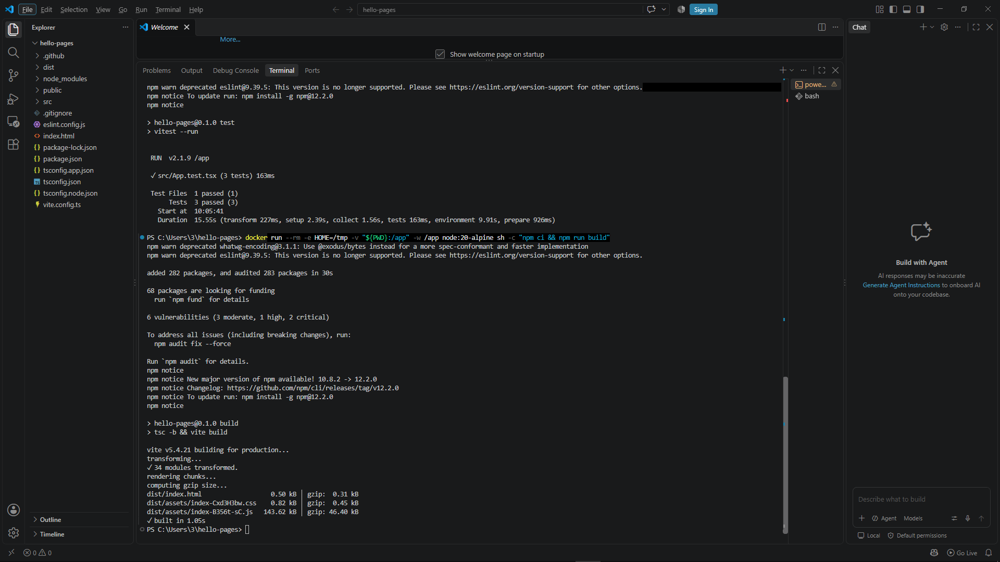
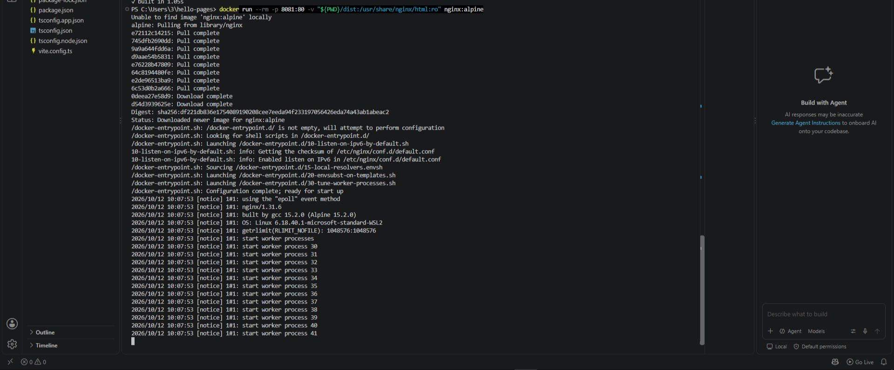
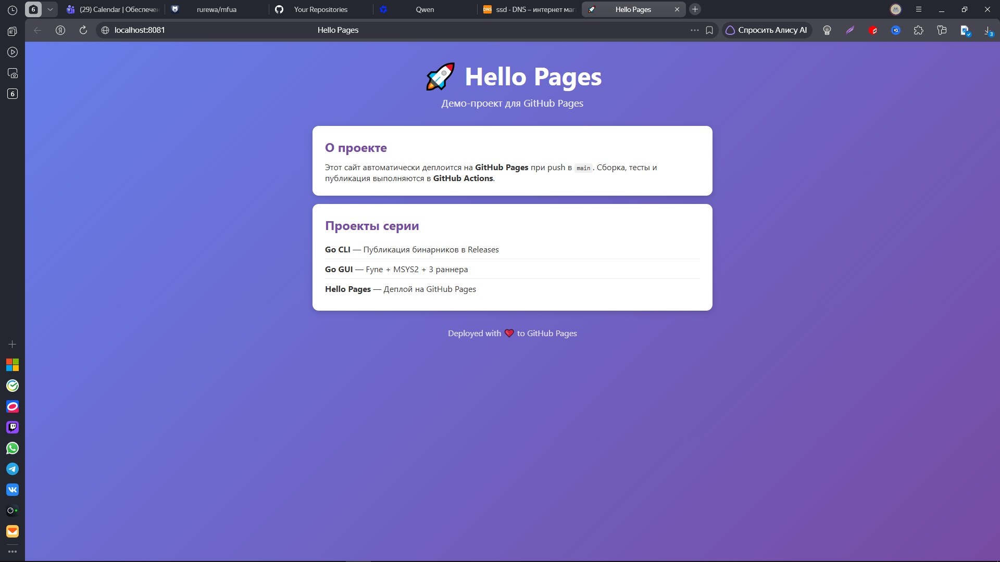
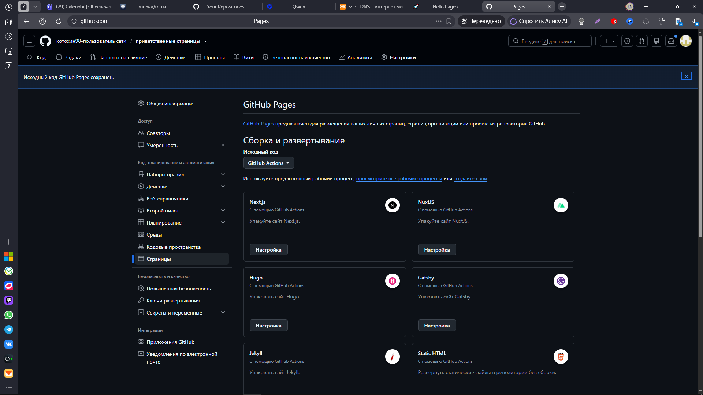
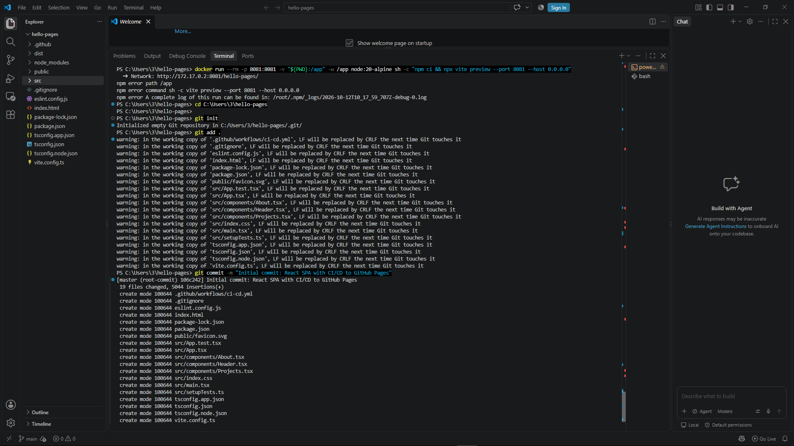
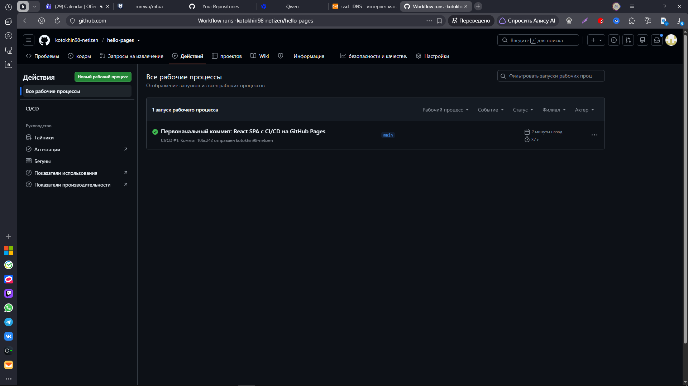
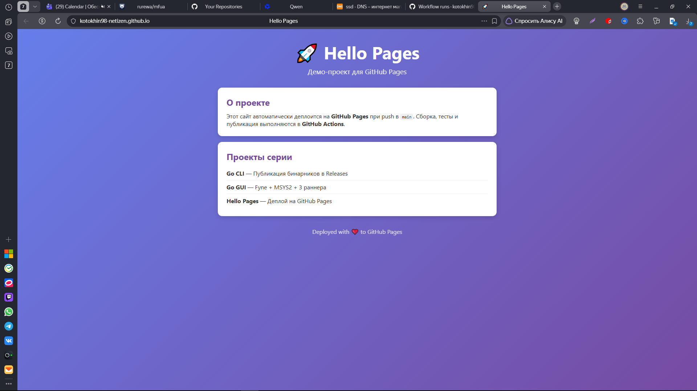
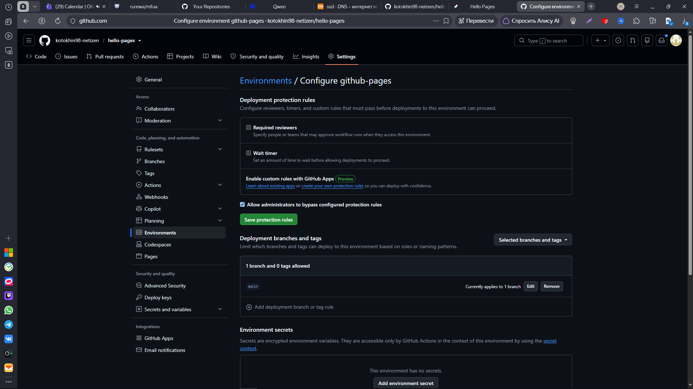

#  Hello Pages — React SPA с CI/CD на GitHub Pages

[](https://github.com/kotokhin98-netizen/hello-pages/actions/workflows/ci-cd.yml)
[](https://kotokhin98-netizen.github.io/hello-pages/)
[](https://react.dev/)
[](https://www.typescriptlang.org/)
[](https://vite.dev/)
[](LICENSE)

Портфолио-сайт на **React + TypeScript + Vite** с автоматическим деплоем на **GitHub Pages** через **GitHub Actions CI/CD**.

 **Живой сайт:** https://kotokhin98-netizen.github.io/hello-pages/

---

## 📑 Содержание

- [О проекте](#о-проекте)
- [Технологии](#технологии)
- [Структура проекта](#структура-проекта)
- [Локальный запуск](#локальный-запуск)
- [CI/CD Pipeline](#cicd-pipeline)
- [Скриншоты](#скриншоты)
- [Что освоено](#что-освоено)
- [Отличия от других проектов](#отличия-от-других-проектов)
- [Частые проблемы](#частые-проблемы)

---

## 🎯 О проекте

Этот проект демонстрирует **настоящий Continuous Deployment** для React Single Page Application:

- ✅ **Vite** — современный сборщик с HMR и быстрым билдом
- ✅ **TypeScript** — типизированный UI без ошибок компиляции
- ✅ **Vitest** — тесты компонентов с `@testing-library/react`
- ✅ **Автоматическая валидация** — ESLint + type-check перед деплоем
- ✅ **Гейтинг деплоя** — `deploy` не запустится, если `ci` упал
- ✅ **Передача артефакта** — `dist/` собирается один раз и передаётся между job'ами
- ✅ **`base` path** — корректные пути ассетов на GitHub Pages
- ✅ **CDN** — GitHub Pages автоматически раздаёт статику по всему миру

---

## 🛠 Технологии

| Категория | Инструмент | Версия |
|-----------|-----------|:------:|
| **Фреймворк** | React | 18.3 |
| **Язык** | TypeScript | 5.6 |
| **Сборщик** | Vite | 5.4 |
| **Тесты** | Vitest + Testing Library | 2.1 / 16.0 |
| **Линтер** | ESLint + typescript-eslint | 9.13 / 8.11 |
| **Хостинг** | GitHub Pages | — |
| **CI/CD** | GitHub Actions | — |
| **Контейнеризация** | Docker (Node 20 Alpine) | — |

---

## 📁 Структура проекта

```
hello-pages/
├── .github/
│   └── workflows/
│       └── ci-cd.yml          # Единый workflow: CI + Deploy
├── public/
│   └── favicon.svg
├── src/
│   ├── components/
│   │   ├── Header.tsx         # Шапка сайта
│   │   ├── About.tsx          # Карточка «О проекте»
│   │   └── Projects.tsx       # Список проектов серии
│   ├── App.tsx                # Корневой компонент
│   ├── App.test.tsx           # Тесты компонента App
│   ├── index.css              # Глобальные стили
│   ├── main.tsx               # Точка входа
│   └── setupTests.ts          # Настройка testing-library
├── .gitignore
├── eslint.config.js           # Конфиг ESLint
── index.html                 # HTML-шаблон
├── package.json
├── package-lock.json          # Обязателен для npm ci
├── tsconfig.json              # Решение TS-проектов
├── tsconfig.app.json          # Конфиг приложения
├── tsconfig.node.json         # Конфиг Node (vite.config.ts)
── vite.config.ts             # ⚠️ base: '/hello-pages/'
```

> 💡 **Ключевой момент:** `base: '/hello-pages/'` в `vite.config.ts` **должен точно совпадать** с именем репозитория. Иначе ассеты не загрузятся (белый экран).

---

## 🖥 Локальный запуск

### Требования
- [Docker Desktop](https://www.docker.com/products/docker-desktop/) (должен быть запущен)
- Git Bash или PowerShell

### 1. Установка зависимостей

```powershell
cd hello-pages
docker run --rm -e HOME=/tmp `
  -v "${PWD}:/app" `
  -w /app `
  node:20-alpine `
  npm install
```

### 2. Запуск тестов

```powershell
docker run --rm -e HOME=/tmp `
  -v "${PWD}:/app" `
  -w /app `
  node:20-alpine `
  sh -c "npm ci && npm test -- --run"
```

**Ожидаемый вывод:**
```
 ✓ src/App.test.tsx (3 tests) 163ms
   ✓ App (3)
     ✓ renders the header
     ✓ renders the about section
     ✓ renders the projects list

 Test Files  1 passed (1)
      Tests  3 passed (3)
```

### 3. Сборка под GitHub Pages

```powershell
docker run --rm -e HOME=/tmp `
  -v "${PWD}:/app" `
  -w /app `
  node:20-alpine `
  sh -c "npm ci && npm run build"
```

**Проверьте `dist/index.html`:** пути должны начинаться с `/hello-pages/`:
```html
<script src="/hello-pages/assets/index-def456.js"></script>
```

### 4. Просмотр собранного сайта

```powershell
docker run --rm -p 8081:8081 `
  -v "${PWD}:/app" `
  -w /app `
  node:20-alpine `
  sh -c "npm ci && npx vite preview --port 8081 --host 0.0.0.0"
```

Откройте: **http://localhost:8081/hello-pages/**

> ⚠️ После проверки нажмите `Ctrl + C` в терминале.

---

## 🔄 CI/CD Pipeline

### Workflow: `ci-cd.yml`

```yaml
name: CI/CD

on:
  push:
    branches: [ main ]
  pull_request:

permissions:
  contents: read
  pages: write
  id-token: write

concurrency:
  group: "pages"
  cancel-in-progress: false

jobs:
  # ===== Job 1: CI — проверки и сборка =====
  ci:
    runs-on: ubuntu-latest
    steps:
      - uses: actions/checkout@v4
      - name: Setup Node.js
        uses: actions/setup-node@v4
        with:
          node-version: '20'
          cache: npm
      - name: Install dependencies
        run: npm ci
      - name: Lint
        run: npm run lint
      - name: Type check
        run: npm run type-check
      - name: Run tests
        run: npm test -- --run
      - name: Build
        run: npm run build
      - name: Upload build artifact
        uses: actions/upload-artifact@v4
        with:
          name: dist
          path: dist
          retention-days: 1

  # ===== Job 2: Deploy — только после успешного CI =====
  deploy:
    needs: ci
    if: github.ref == 'refs/heads/main'
    runs-on: ubuntu-latest
    environment:
      name: github-pages
      url: ${{ steps.deployment.outputs.page_url }}
    steps:
      - name: Download build artifact
        uses: actions/download-artifact@v4
        with:
          name: dist
          path: dist
      - name: Setup Pages
        uses: actions/configure-pages@v5
      - name: Upload artifact to Pages
        uses: actions/upload-pages-artifact@v3
        with:
          path: ./dist
      - name: Deploy to GitHub Pages
        id: deployment
        uses: actions/deploy-pages@v4
```

### Как это работает

```
┌─────────────────────────────────────────────────────────┐
│  Push в main                                            │
└────────────────────┬────────────────────────────────────┘
                     ▼
┌─────────────────────────────────────────────────────────
│  Job: ci                                                │
│  • npm ci                                               │
│  • lint (ESLint)                                        │
│  • type-check (tsc --noEmit)                            │
│  • test (Vitest)                                        │
│  • build (tsc -b && vite build)                         │
│  • upload-artifact (папка dist/)                        │
└────────────────────┬────────────────────────────────────┘
                     │ needs: ci
                     ▼
┌─────────────────────────────────────────────────────────┐
│  Job: deploy (только если ci ✅)                         │
│  • download-artifact (dist/)                            │
│  • configure-pages                                      │
│  • upload-pages-artifact (path: ./dist)                 │
│  • deploy-pages → GitHub Pages CDN                      │
─────────────────────────────────────────────────────────┘
```

### Почему один файл, а не два?

GitHub Actions **не поддерживает** `needs` между разными workflow-файлами. Чтобы Deploy **ждал** CI, оба job'а должны быть в **одном** `.yml` файле.

### Continuous Deployment vs Continuous Delivery

| Тип | Описание | Этот проект |
|-----|----------|:-----------:|
| **CI** | Автоматическая проверка кода | ✅ `job: ci` |
| **CDel** | Готовит релиз, деплой вручную | ❌ |
| **CDep** | Автодеплой после CI | ✅ `job: deploy` |

> 💡 **Ключевая особенность:** `needs: ci` — деплой **не запустится**, если валидация упала. Это и есть настоящий Continuous Deployment.

---

## 📸 Скриншоты

### Локальные тесты (Vitest)


### Локальная сборка (Vite build)


### Настройка GitHub Pages


### Успешный CI/CD


### Environment: github-pages


### Deployments


### Живой сайт


---

## 🎓 Что освоено

- **Vite** — современный сборщик с HMR, быстрым билдом и оптимизацией
- **React + TypeScript** — типизированный UI с проверкой типов на этапе сборки
- **Vitest** — тесты компонентов, аналогичные Jest, но нативно для Vite
- **GitHub Pages** — бесплатный хостинг с HTTPS и CDN
- **GitHub Actions** — единый workflow с двумя job'ами (`ci` + `deploy`)
- **`needs: ci`** — гейтинг деплоя (настоящий CD)
- **`actions/upload-artifact` / `download-artifact`** — передача `dist/` между job'ами
- **`base` path** — специфика Pages для Vite (префикс в путях ассетов)
- **`environment: github-pages`** — привязка к окружению с историей
- **`permissions: pages: write`** — права для деплоя
- **`concurrency: pages`** — защита от параллельных деплоев
- **Environments & Deployments** — история развёртываний
- **Docker** — локальная проверка через контейнеры Node и Nginx

---

## 🔑 Отличия от других проектов серии

| Аспект | Go CLI/GUI | Hello Static | **Hello Pages** |
|--------|:----------:|:------------:|:---------------:|
| **Что публикуется** | Бинарник | HTML/CSS/JS файлы | React SPA (собранный `dist/`) |
| **Куда** | GitHub Releases | GitHub Pages | GitHub Pages |
| **Как получить** | Скачать файл | Открыть URL | Открыть URL |
| **Триггер** | Тег `v*` | Push в `main` | Push в `main` |
| **Архитектура CI/CD** | 2 workflow | 1 workflow | **1 workflow с `needs: ci`** |
| **Сборка** | `go build` | Нет сборки | **Vite + tsc** |
| **Тесты** | Нет | Нет | **Vitest** |
| **Типизация** | Go | Нет | **TypeScript** |
| **`base` path** | — | Не нужен | **Обязателен** |
| **Environments** | Опционально | `github-pages` | **`github-pages`** |
| **Тип CD** | Continuous Delivery | **Continuous Deployment** | **Continuous Deployment** |

---

## ⚠️ Частые проблемы

| Проблема | Решение |
|----------|---------|
| Белый экран на сайте | Проверьте `base` в `vite.config.ts` — должно совпадать с именем репо |
| `Pages site not found` | Settings → Pages → Source: **GitHub Actions** |
| `Resource not accessible by integration` | Добавьте `permissions: pages: write` в workflow |
| `npm ci can only install...` | Сгенерируйте `package-lock.json` через `npm install` |
| `Found multiple elements` в тестах | Используйте `getByRole` вместо `getByText` |
| Деплой не запускается | Это нормально! `needs: ci` ждёт завершения CI |
| Ссылка не видна на главной | About → ⚙️ → **Use your GitHub Pages website** |
| 404 на `localhost:8081` | Откройте `http://localhost:8081/hello-pages/` (с префиксом!) |

---

## 📝 Лицензия

MIT © 2026 kotokhin98-netizen












---

> 💡 **Главный урок:** Deploy ≠ Releases. **Release** — это упакованный артефакт для скачивания. **Deploy** — это **работающее приложение по URL**. А **настоящий CD** — это когда деплой **не запускается**, пока CI не прошёл успешно. Именно это мы сделали через `needs: ci`.